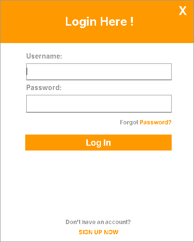
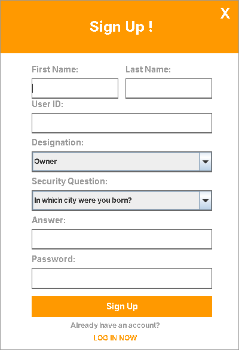
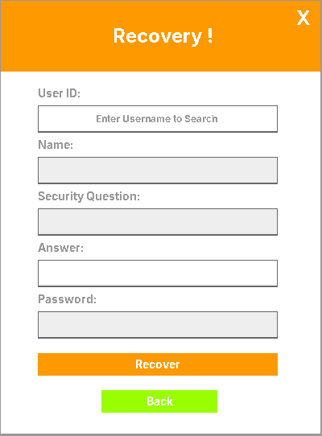
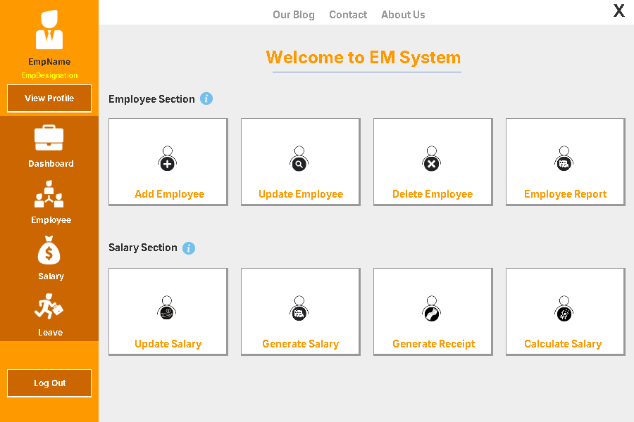
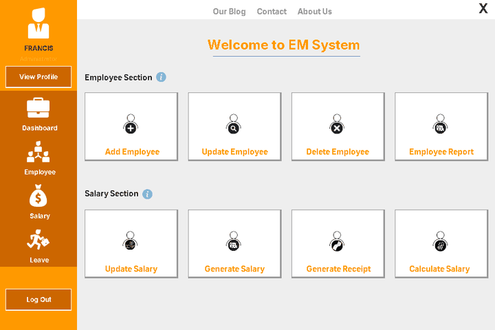

# EM System: Employee Management System

**Employees · Salaries · Records**

A Java desktop application for managing employee records, salaries, and receipts. Built with Java Swing and MySQL, it lets a business owner or administrator sign up, log in, and handle employee and salary tasks from one menu.

## Project Overview

The Employee Management System (EM System) is a desktop application that centralizes employee records, salary processing, and leave tracking. Users create an account, log in, and use the main menu to manage employees and salaries.

## Screenshots

### Login


### Sign Up


### Forgot Password


### Main Menu


### Add, Update and Delete Employee


## Features

- **Account Sign Up and Login** – Users register with a user ID, designation, and security question, then log in to access the system.
- **Forgot Password** – Password recovery through the security question set at sign up.
- **Add Employee** – Add new employee records.
- **Update Employee** – Search for an employee by ID and update their details.
- **Delete Employee** – Remove an employee record.
- **Employee Report** – View employee records and their status.
- **Update Salary** – Edit an employee's salary information.
- **Generate Salary** – Generate salary records for employees.
- **Calculate Salary** – Calculate an employee's salary.
- **Generate Receipt** – Produce a salary receipt.
- **Dashboard and Leave** – Sidebar sections for the overview and leave management.
- **View Profile** – View the logged-in user's profile.

## Tech Stack

| Technology | Purpose |
|---|---|
| Java 17 | Programming language |
| Java Swing | Desktop user interface |
| NetBeans AbsoluteLayout | UI layout |
| MySQL | Database |
| MySQL Connector/J 8.1.0 | Database driver |
| Apache Ant | Build system (NetBeans project) |

## Installation and Setup

### Prerequisites

- JDK 17 or higher
- MySQL Server (for example through XAMPP)
- NetBeans IDE (recommended)

### 1. Clone the repository

```bash
git clone https://github.com/frncsrys/employeems.git
cd employeems
```

### 2. Set up the database

Create a MySQL database named `db`. The app connects with these settings in `src/main/MyConnection.java`:

```
URL:      jdbc:mysql://localhost/db
User:     root
Password: (empty)
```

Change these values if your MySQL setup is different.

### 3. Run the application

**With NetBeans:** open the project and click **Run**.

**From the command line:**

```bash
cd dist
java -jar "Employee_Management_System.jar"
```

Keep the `lib` folder next to the `.jar` file, since it holds the required libraries.

---

## Author

Developed by Francis ([@frncsrys](https://github.com/frncsrys)).

**Date:** December 10, 2023